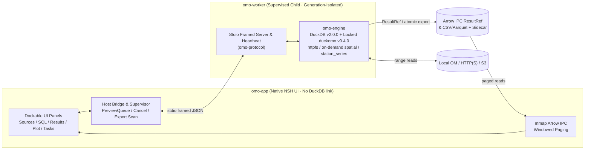

# Omobench (OmO)

[中文](README.md) | English

Omobench (repository `chorust/OmO`, alias `duckomo-workbench`) is a pure-Rust native desktop and headless workbench built on [NSH](https://crates.io/crates/nsh-core), [DuckDB](https://github.com/duckdb/duckdb), and [duckomo](https://github.com/chorust/duckomo) for querying, inspecting, charting, and exporting [Open-Meteo OM](https://github.com/open-meteo/om-file-format) gridded weather and station time-series data with provenance.

[Features](#features) · [Install](#install) · [Usage](#usage) · [Architecture](#architecture) · [Dev](#dev) · [Docs](#docs) · [Acknowledgements](#acknowledgements)

## Features

- **Native Rust desktop workbench (`omo-app`)**: Pure-Rust NSH `0.5.1` dockable shell with **Sources**, **SQL editor**, **Results**, **Plot**, and **Tasks** panels — no Electron or WebView runtime.
- **Supervised out-of-process engine (`omo-worker`)**: Runs DuckDB and `duckomo` in a dedicated child process communicating over framed stdio JSON and on-disk Arrow IPC (`ResultRef`) files, with generation isolation, heartbeats, automatic crash restart, preview coalescing, and three-level cancellation.
- **Per-connection verified & locked bootstrap**: Every connection boots pinned DuckDB `v2.0.0` (`duckdb-rs =1.20000.1`) and `duckomo v0.4.0` verified by per-channel × per-platform SHA-256 locks ([artifacts/duckomo.lock.json](artifacts/duckomo.lock.json)). Supports explicit `community-signed` (pinned public key + private local repository) and `github-release-unsigned` channels with zero silent signed-to-unsigned fallback, plus on-demand `spatial` pre-provisioning before configuration lock (R4).
- **Large-result paging & interactive plotting**: Memory-mapped Arrow IPC window paging and server-side sort re-fetch (verified on a 1,000,000 × 20 dataset), multi-series line plotting with hover inspection (M0 cap: 20 × 10,000 points), and explicit stale-result indication whenever SQL is edited.
- **Stable station-series contract**: Standardizes downstream output on `station_series(station_id, variable, valid_time, value, grid_lat, grid_lon, distance_m, source_object, object_version)`. For M0 on eligible regular spherical lon/lat grids, Plan B (`read_om_regions(method := 'nearest')`) is selected with Plan A retained as a full-grid fallback, both verified against an independent value oracle.
- **Atomic export with provenance**: Exports active-generation results to `.csv` or `.parquet` alongside a JSON provenance sidecar. The atomic sidecar rename is the single commit point, and startup recovery scans for incomplete exports.
- **Headless core & enforced boundaries**: Core crates (`omo-engine`, `omo-protocol`, `omo-worker`, `omo-project`) carry zero UI framework dependencies, and the release `omo-app` build does not link DuckDB — enforced in CI via `scripts/check-boundaries.sh`.

> **Current stage (M0 · `v0.1.0-m0`)**: This release delivers the **M0 skeleton engine and native shell**. Project persistence, full UI station CSV ingestion, populated product catalogs (`catalog/products.json` is currently an `omo-catalog/0` placeholder), static regional maps (M2), declarative reports (L1), and Dynamical Icechunk ingestion (M3) are planned for subsequent milestones — see [Roadmap](.specify/memory/roadmap.md). Prebuilt `v0.1.0-m0` archives cover four platforms, while `artifacts/duckomo.lock.json` currently locks `linux_amd64`, `linux_arm64`, and `osx_arm64` (`macos-x86_64` is build-only in CI).

## Install

### GitHub Release

Download the archive matching your platform from [GitHub Releases](https://github.com/chorust/OmO/releases). Each archive contains a matched pair of `omo-app` and `omo-worker` binaries:

| Platform | Release archive (`v0.1.0-m0`) | Locked Duckomo support |
| :--- | :--- | :--- |
| Linux x86_64 | `omobench-v0.1.0-m0-linux-x86_64.tar.gz` | `linux_amd64` (locked & CI-verified) |
| Linux ARM64 | `omobench-v0.1.0-m0-linux-aarch64.tar.gz` | `linux_arm64` (locked & CI-verified) |
| macOS Apple Silicon | `omobench-v0.1.0-m0-macos-aarch64.tar.gz` | `osx_arm64` (locked & CI-verified) |
| macOS Intel | `omobench-v0.1.0-m0-macos-x86_64.tar.gz` | Build-only (`osx_amd64` not in `duckomo.lock.json`) |

Download and unpack both binaries into the same directory (`omo-app` locates its sibling `omo-worker` automatically):

```bash
VERSION=v0.1.0-m0
ASSET=linux-x86_64   # one of: linux-x86_64 | linux-aarch64 | macos-aarch64 | macos-x86_64

mkdir -p omobench && cd omobench
curl -fL "https://github.com/chorust/OmO/releases/download/${VERSION}/omobench-${VERSION}-${ASSET}.tar.gz" \
  | tar -xz
ls -l omo-app omo-worker
```

Running the Linux desktop app requires GTK4, Pango, and GStreamer runtime libraries (see [Linux prerequisites](docs/m0/linux-prereqs.md) for Ubuntu 24.04 packages).

### Fetch the locked Duckomo extension artifact

Engine bootstrap requires a locally verified `duckomo v0.4.0` (DuckDB `v2.0.0`) extension archive. From a repository checkout, fetch and verify against [artifacts/duckomo.lock.json](artifacts/duckomo.lock.json):

```bash
# channel:  community-signed | github-release-unsigned
# platform: linux_amd64 | linux_arm64 | osx_arm64
scripts/fetch-duckomo.sh community-signed linux_amd64
```

You can also download the `.duckdb_extension.gz` file manually using the URL and `sha256` recorded in [artifacts/duckomo.lock.json](artifacts/duckomo.lock.json). To build from source, see [Dev](#dev).

## Usage

### Launch the desktop workbench (`omo-app`)

`omo-app` reads its engine bootstrap configuration JSON from `OMOBENCH_BOOTSTRAP_CONFIG` (all paths in the config must be **absolute**), spawns the sibling `omo-worker` (override with `OMOBENCH_WORKER`), and opens the workbench.

Create a bootstrap config (e.g., `bootstrap.json`), copying the matching channel/platform entry from [artifacts/duckomo.lock.json](artifacts/duckomo.lock.json) into `artifact`:

```json
{
  "data_dir": "/abs/path/to/omobench-data",
  "ext_cache_dir": "/abs/path/to/omobench-ext-cache",
  "artifact_path": "/abs/path/to/duckomo.duckdb_extension.gz",
  "fixture_path": "/abs/path/to/OmO/fixtures/om/chmi-aladin-cz-hsurf.om",
  "platform": "linux_amd64",
  "artifact": {
    "...": "copy the matching channel + platform entry from artifacts/duckomo.lock.json"
  },
  "threads": 4,
  "httpfs_timeout_ms": 15000,
  "no_network": false,
  "install_spatial_before_lock": false
}
```

Launch the workbench:

```bash
OMOBENCH_BOOTSTRAP_CONFIG=/abs/path/to/bootstrap.json ./omo-app
```

Common environment variables:

| Variable | Description |
| :--- | :--- |
| `OMOBENCH_BOOTSTRAP_CONFIG` | Required (unless using offline fixture mode): path to the bootstrap JSON config |
| `OMOBENCH_WORKER` | Optional: explicit path to the `omo-worker` executable |
| `OMOBENCH_INITIAL_SQL` | Optional: initial SQL populated in **SQL editor** on startup |
| `OMOBENCH_FIXTURE_RESULT` | Optional: load an offline Arrow IPC file directly into **Results / Plot** without starting a worker |
| `OMOBENCH_MAIN_THREAD_LOG` | Optional (Linux): write GTK main-loop callback interval diagnostics to a JSONL file |
| `NSH_FPS=1` | Optional: log NSH frame-rate diagnostics to stderr |

Interactive workflow:
1. Write SQL in **SQL editor** and run a preview; editing SQL marks the existing table as belonging to an earlier revision so received data is never confused with current edits.
2. Browse paged rows and click column headers in **Results** to trigger server-side sort re-fetches; inspect multi-series charts and hover values in **Plot**.
3. Monitor worker status, generation, and bootstrap reports in **Tasks**, cancel active queries, or export current-generation results to `.csv` / `.parquet` with atomic provenance sidecars.

### Headless bootstrap probe (`omo-probe`)

Verify DuckDB `v2.0.0` + `duckomo v0.4.0` bootstrap repeatability, R4 `spatial` provisioning, and offline isolation headlessly:

```bash
# Verify community-signed channel across 100 fresh connections
cargo +1.100.0 run -p omo-worker --bin omo-probe --locked -- \
  --channel community-signed \
  --artifact /abs/path/to/duckomo.duckdb_extension.gz \
  --repeat 100

# Verify GitHub release unsigned channel + R4 spatial pre-provisioning
cargo +1.100.0 run -p omo-worker --bin omo-probe --locked -- \
  --channel github-release-unsigned \
  --artifact /abs/path/to/duckomo-v0.4.0-duckdb-v2.0.0-linux_amd64.duckdb_extension.gz \
  --r4

# Verify no-network mode
cargo +1.100.0 run -p omo-worker --bin omo-probe --locked -- \
  --channel community-signed \
  --artifact /abs/path/to/duckomo.duckdb_extension.gz \
  --no-network
```

### Station-series sampling validator (`omo-series-spike`)

Compare Plan A (full-grid scan + station join) vs. Plan B (`read_om_regions(method := 'nearest')`) against the retained independent oracle:

```bash
cargo +1.100.0 run -p omo-worker --bin omo-series-spike --locked -- \
  --plan B \
  --channel community-signed \
  --artifact /abs/path/to/duckomo.duckdb_extension.gz
```

### Development & fault-injection harness (`omo-harness`)

Generate large synthetic Arrow IPC results and test progress streaming, worker crash recovery, cancellation levels, and atomic export recovery:

```bash
# Generate a 1M x 20 Arrow IPC fixture and open it directly in omo-app
cargo +1.100.0 run -p omo-app --bin omo-harness --locked -- \
  gen-result --rows 1000000 --cols 20 --output /tmp/omo-1m.arrow
OMOBENCH_FIXTURE_RESULT=/tmp/omo-1m.arrow cargo +1.100.0 run -p omo-app --bin omo-app --locked

# Other subcommands: progress | crash-inject | cancel | export-kill
cargo +1.100.0 run -p omo-app --bin omo-harness --locked -- --help
```

## Architecture

### Process & data flow



### Workspace layout

| Crate | Binaries | Responsibilities & boundaries |
| :--- | :--- | :--- |
| [crates/omo-app](crates/omo-app) | `omo-app`, `omo-harness` | Native NSH UI, main-thread probe, worker supervision, preview coalescing, Arrow IPC paging, and stress/fault harness; default release build **does not link DuckDB** |
| [crates/omo-worker](crates/omo-worker) | `omo-worker`, `omo-probe`, `omo-series-spike` | Supervised child worker executable, heartbeat/cancel orchestration, bootstrap probe, and station-series validator; **UI-free** |
| [crates/omo-engine](crates/omo-engine) | *(library)* | Per-connection locked DuckDB/duckomo bootstrap, SHA-256 & signing-key verification, query execution, Arrow IPC result & plot sampling, `station_series` plans, atomic export + sidecar; **UI-free** |
| [crates/omo-protocol](crates/omo-protocol) | *(library)* | Framed stdio IPC envelopes, worker generations, 3-level cancel states, error taxonomy, `ResultRef` / `PlotRef`, and export commit messages; **UI-free** |
| [crates/omo-project](crates/omo-project) | *(library)* | Project document schema and `PreviewKey` definitions; **UI-free** |

### Core architectural invariants

1. **Strict UI / engine isolation**: `omo-engine`, `omo-protocol`, `omo-worker`, and `omo-project` must never depend on `nsh-*`, `gpui*`, or `tauri*`. Default `omo-app` builds must not link `duckdb` / `libduckdb-sys`, and `omo-app/src/host/` must not reference `nsh_*`.
2. **Per-connection locked bootstrap**: Every connection validates and loads pinned extensions in a deterministic sequence before locking configuration. A `community-signed` verification failure never silently falls back to `github-release-unsigned`.
3. **Explicit state boundaries & atomic commit**: Edited, staged, received (active vs. stale generation), and saved states are kept distinct; exports commit strictly via atomic sidecar rename.
4. **Stable downstream schema**: UI, exports, and future reports consume the single `station_series` schema regardless of underlying source or sampling plan.

### Roadmap summary

| Milestone | Status | Scope |
| :--- | :--- | :--- |
| **001 · M0 Skeleton Engine** | Released (`v0.1.0-m0`) | Skeleton engine, locked bootstrap, supervised worker, NSH native shell, station-series plan decision, CI & release verification |
| **002 · M1 Station Time Series** | Planned | Product catalog integration (default: ECMWF IFS HRES · 2 m temperature · 0–7 day horizon), UI station CSV ingestion, station time-series workflows, and project persistence |
| **003 · M2 Static Regional Map** | Needs refinement | Revision-bound regional map jobs, PNG + sidecar export |
| **004 · L1 Declarative Reports** | Needs refinement | Versioned `ReportSpec` (`omo-report/1`), allow-listed Rust renderer on frozen read-only snapshots |
| **005 · M3 Dynamical Icechunk** | Needs refinement | Unified `Source` abstraction, STAC discovery, and Icechunk backend emitting the same `station_series` schema |

## Dev

### Prerequisites

- **Rust**: `1.100.0` (pinned in [rust-toolchain.toml](rust-toolchain.toml), workspace MSRV `1.97`)
- **Linux (Ubuntu 24.04)**:
  ```bash
  sudo apt-get update
  sudo apt-get install -y build-essential pkg-config \
    libgtk-4-dev libpango1.0-dev \
    libgstreamer1.0-dev libgstreamer-plugins-base1.0-dev
  ```
- **macOS (14+ / 15)**: Xcode Command Line Tools
- **Python 3**: Required for dependency-boundary checks, Duckomo verification, and helper scripts

### Build, test & verify

```bash
# Locked workspace build and unit/integration tests
cargo +1.100.0 build --workspace --locked
cargo +1.100.0 test --workspace --locked

# Dependency boundary check + injected-violation self-test
scripts/check-boundaries.sh
scripts/check-boundaries.sh --self-test

# Fetch locked Duckomo artifacts for this host and verify bootstrap + live worker
python3 scripts/ci-verify-duckomo.py --repeat 3

# Verify vendor-provenance snapshot hashes
python3 scripts/verify-duckling-snapshot.py

# Build release binaries (matches .github/workflows/release.yml)
cargo +1.100.0 build --release --locked --bin omo-app --bin omo-worker
```

On memory-constrained ARM64 hosts, set `CARGO_BUILD_JOBS=2` (as configured in [.github/workflows/ci.yml](.github/workflows/ci.yml) and [.github/workflows/release.yml](.github/workflows/release.yml)).

CI covers `ubuntu-24.04` (`linux_amd64`), `ubuntu-24.04-arm` (`linux_arm64`), `macos-15` (`osx_arm64`), and `macos-15-intel` (build + tests). Local interactive desktop evidence (X11, nested Weston Wayland, and explicitly disclosed `not-run` cells) is tracked in [M0 Acceptance Matrix](docs/m0/acceptance.md).

## Docs

| Topic | Document |
| :--- | :--- |
| M0 specification & validation quickstart | [M0 Spec](specs/001-m0-skeleton-engine/spec.md) · [Quickstart](specs/001-m0-skeleton-engine/quickstart.md) |
| Acceptance matrix & measurements | [Acceptance Matrix](docs/m0/acceptance.md) · [Linux Prerequisites](docs/m0/linux-prereqs.md) |
| Architecture decision records | [Channel Decision](docs/m0/decisions/channel.md) · [Series Plan](docs/m0/decisions/series-plan.md) · [R4 Spatial](docs/m0/decisions/r4.md) · [NSH Shell](docs/m0/decisions/shell.md) · [Engine Source](docs/m0/decisions/engine-source.md) |
| Locked extension hashes & keys | [duckomo.lock.json](artifacts/duckomo.lock.json) |
| Roadmap & constitution | [Roadmap](.specify/memory/roadmap.md) · [Constitution](.specify/memory/constitution.md) |
| Upstream provenance | [Duckling Provenance](vendor-provenance/DUCKLING.md) |

## Acknowledgements

- [DuckDB](https://github.com/duckdb/duckdb) & [duckdb-rs](https://github.com/duckdb/duckdb-rs): Embedded analytical SQL engine and `httpfs` / `spatial` extensions.
- [duckomo](https://github.com/chorust/duckomo): DuckDB extension for direct Open-Meteo OM grid and region reading.
- [Open-Meteo OM File Format](https://github.com/open-meteo/om-file-format) & [Open-Meteo Open Data](https://github.com/open-meteo/open-data): OM specification and public weather datasets.
- [NSH](https://crates.io/crates/nsh-core): Pure-Rust native cross-platform desktop UI framework (Linux GTK4 / macOS).
- [Apache Arrow](https://arrow.apache.org/): Columnar IPC format for memory-mapped result exchange across processes.
- [Duckling](vendor-provenance/DUCKLING.md): Provenance-tracked upstream reference for selected engine bootstrap, query, cancellation, and export seams.

See [LICENSE](LICENSE) (GNU AGPL v3.0) at the repository root. Weather datasets and upstream extensions remain subject to their respective providers' license and attribution terms.
