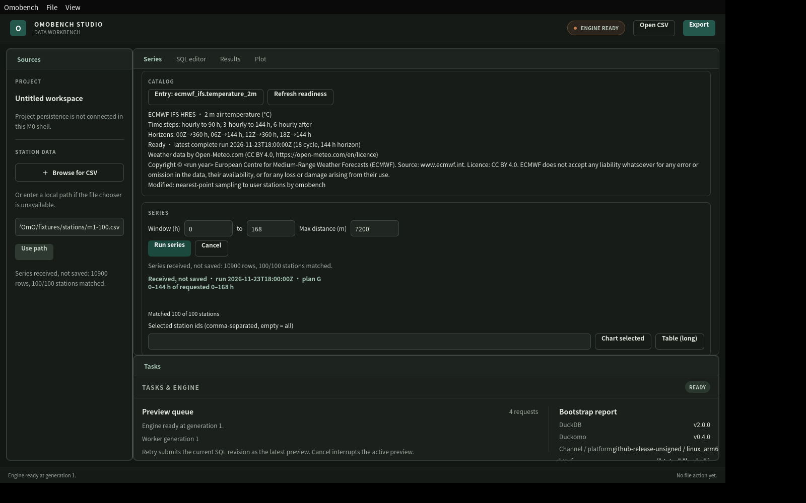
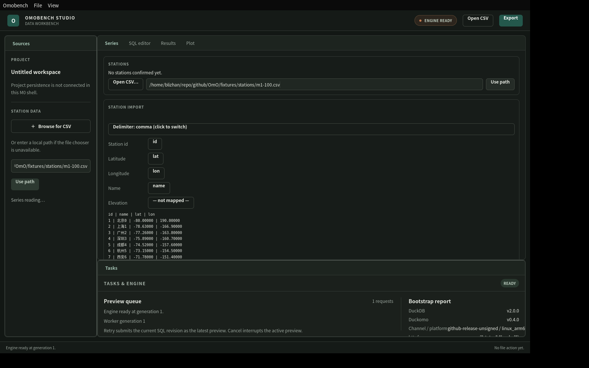
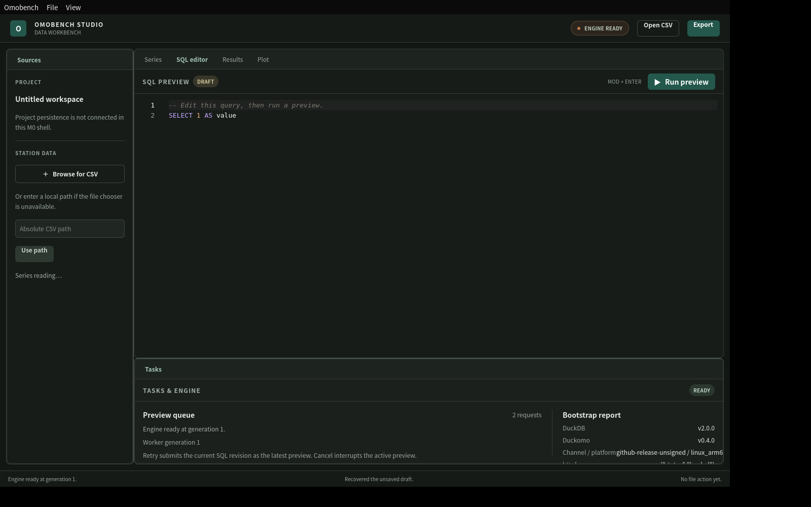
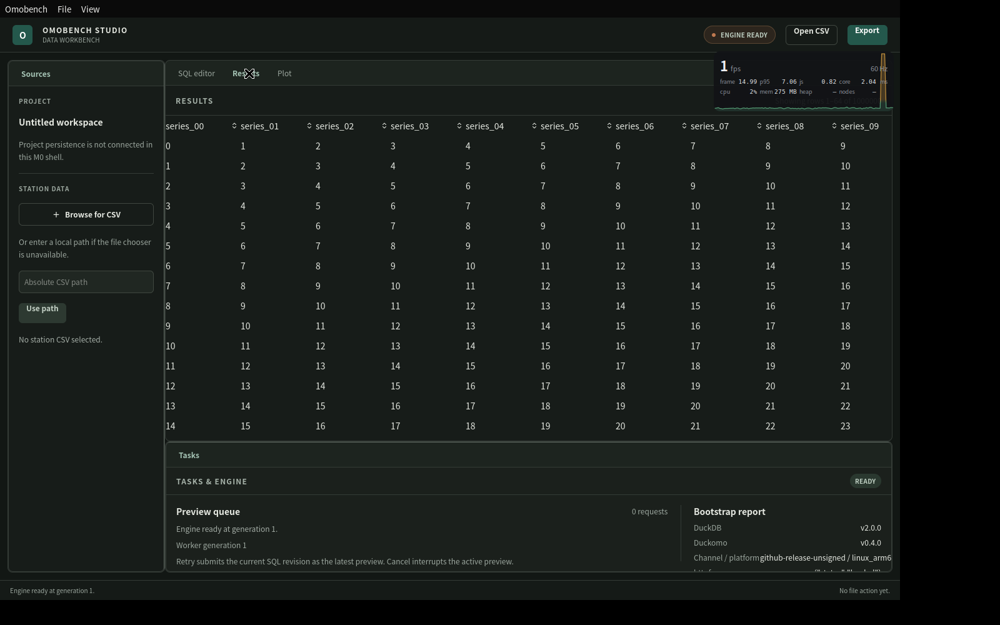
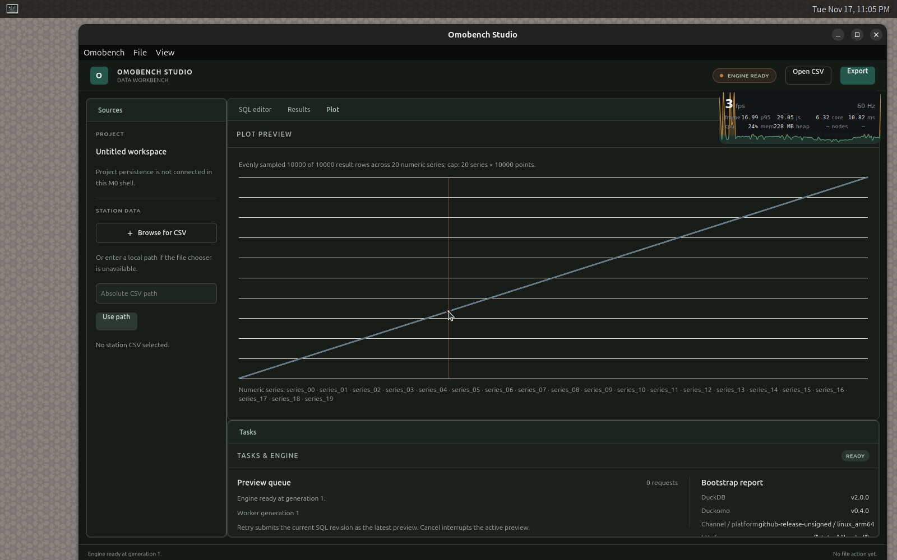
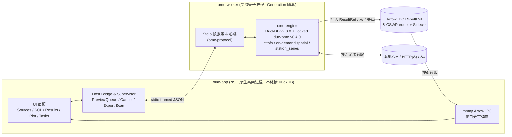

# Omobench (OmO)

中文 | [English](README.en.md)

Omobench（仓库 `chorust/OmO`，别名 `duckomo-workbench`）是一个基于纯 Rust 原生界面（[NSH](https://crates.io/crates/nsh-core)）、[DuckDB](https://github.com/duckdb/duckdb) 与 [duckomo](https://github.com/chorust/duckomo) 构建的桌面与无头气象数据工作台，用于直接查询、浏览、绘图并带溯源信息导出 [Open-Meteo OM](https://github.com/open-meteo/om-file-format) 网格与站点时间序列数据。

[Features](#features) · [Screenshots](#screenshots) · [Install](#install) · [Usage](#usage) · [Architecture](#architecture) · [Dev](#dev) · [Docs](#docs) · [Acknowledgements](#acknowledgements)

## Features

- **原生 Rust 桌面工作台（`omo-app`）**：基于 NSH `0.5.1` 的多面板可停靠界面，提供 **Sources**、**SQL editor**、**Results**、**Plot** 和 **Tasks** 视图，无 Electron / WebView 依赖。
- **进程隔离的受监管引擎（`omo-worker`）**：DuckDB 与 `duckomo` 运行在独立子进程中，通过 stdio 帧协议和磁盘上的 Arrow IPC（`ResultRef`）与界面通信；支持 generation 隔离、心跳检测、崩溃自动重启、预览请求合并以及三级取消机制。
- **逐连接校验与锁定引导**：每个连接按固定版本启动 DuckDB `v2.0.0`（`duckdb-rs =1.20000.1`）与 `duckomo v0.4.0`；按渠道与平台锁定 SHA-256（[artifacts/duckomo.lock.json](artifacts/duckomo.lock.json)），支持 `community-signed`（锁定公钥 + 私有本地仓库）与 `github-release-unsigned` 两条显式渠道，绝不静默降级回退；支持锁配置前按需预装 `spatial`（R4）。
- **大结果分页与交互绘图**：结果表通过 mmap 读取 Arrow IPC 按可见窗口分页与服务端排序重拉（已在百万行×20 列样本上验证）；绘图视图提供多序列折线展示与悬停查看（M0 上限 20×10,000 点），编辑 SQL 后明确标示过期结果状态。
- **稳定站点序列契约**：围绕统一的 `station_series` 输出表结构（`station_id, variable, valid_time, value, grid_lat, grid_lon, distance_m, source_object, object_version`），M0 对支持的规则球面经纬度网格选定 Plan B（`read_om_regions(method := 'nearest')`），保留 Plan A 全网格回退路径并通过独立真值对照。
- **原子导出与溯源**：支持将当前有效 generation 的结果导出为 `.csv` 或 `.parquet`，附带 JSON 溯源 sidecar，以 sidecar 原子重命名作为唯一提交点，并在启动时扫描恢复未完成导出。
- **无头核心与严格依赖边界**：核心 crate（`omo-engine`、`omo-protocol`、`omo-worker`、`omo-project`）不依赖任何 UI 框架，`omo-app` 发布构建不链接 DuckDB，由 CI 中的 `scripts/check-boundaries.sh` 强制校验。

> **当前阶段（M1 · `v0.1.0-m1`）说明**：当前发布对应 **M1 站点 × 预报时序工作台**（ECMWF IFS HRES 目录、站点 CSV 导入、Plan G / Plan B 时序查询与多站绘图、SQL 视图、`omo-export-sidecar/2` 溯源导出与 `.omoproj` 工程持久化）。静态区域地图（M2）、声明式报告（L1）及 Dynamical Icechunk 数据源（M3）规划在后续里程碑实现，详见 [Roadmap](.specify/memory/roadmap.md)。此外，`v0.1.0-m1` 提供四个平台的预编译二进制，其中 `artifacts/duckomo.lock.json` 当前锁定 `linux_amd64`、`linux_arm64` 与 `osx_arm64`（`macos-x86_64` 当前在 CI 中为仅构建验证）。

## Screenshots

以下截图采集自参考主机（Ubuntu 24.04 ARM64，NSH `0.5.1` 原生界面，DuckDB `v2.0.0` + `duckomo v0.4.0`）：


*M1 Series 面板：ECMWF IFS HRES 2 m 气温目录就绪状态、100/100 站点 Plan G 最近格点采样结果、`Received, not saved` 明确状态提示与底部 Tasks / Bootstrap 报告。*

| 站点 CSV 导入与列映射预览 | SQL 编辑器 |
| :---: | :---: |
|  |  |
| *自动推断分隔符与字段映射（`id`/`lat`/`lon`/`name`），支持 UTF-8 中文站点名预览。* | *内置 DuckDB SQL 预览编辑器（`Mod + Enter` 执行）与草稿状态指示。* |

| 百万行结果分页表格 | 多序列折线绘图与悬停查看 |
| :---: | :---: |
|  |  |
| *基于 mmap Arrow IPC 的大结果集分页表格与列排序（1,000,000 × 20 样本）。* | *20 序列 × 10,000 点折线渲染与十字准线悬停查看（Wayland 原生窗口）。* |

## Install

### GitHub Release

从 [GitHub Releases](https://github.com/chorust/OmO/releases) 下载与当前平台匹配的归档包，每个压缩包均包含配对的 `omo-app` 与 `omo-worker` 两个可执行文件：

| 平台 | Release 资产（`v0.1.0-m1`） | Duckomo 锁定支持 |
| :--- | :--- | :--- |
| Linux x86_64 | `omobench-v0.1.0-m1-linux-x86_64.tar.gz` | `linux_amd64`（已锁定并经 CI 验证） |
| Linux ARM64 | `omobench-v0.1.0-m1-linux-aarch64.tar.gz` | `linux_arm64`（已锁定并经 CI 验证） |
| macOS Apple Silicon | `omobench-v0.1.0-m1-macos-aarch64.tar.gz` | `osx_arm64`（已锁定并经 CI 验证） |
| macOS Intel | `omobench-v0.1.0-m1-macos-x86_64.tar.gz` | 仅构建验证（`duckomo.lock.json` 暂未包含 `osx_amd64`） |

下载并解压到同一目录（`omo-app` 默认在同级目录查找 `omo-worker`）：

```bash
VERSION=v0.1.0-m1
ASSET=linux-x86_64   # 可选: linux-x86_64 | linux-aarch64 | macos-aarch64 | macos-x86_64

mkdir -p omobench && cd omobench
curl -fL "https://github.com/chorust/OmO/releases/download/${VERSION}/omobench-${VERSION}-${ASSET}.tar.gz" \
  | tar -xz
ls -l omo-app omo-worker
```

Linux 运行桌面端需本机具备 GTK4、Pango 与 GStreamer 运行库（Ubuntu 24.04 完整依赖见 [Linux 前置依赖](docs/m0/linux-prereqs.md)）。

### 获取锁定的 Duckomo 扩展产物

引导引擎需要本地已校验的 `duckomo v0.4.0`（DuckDB `v2.0.0`）扩展产物。在仓库中可使用校验脚本下载并核对 [artifacts/duckomo.lock.json](artifacts/duckomo.lock.json)：

```bash
# 渠道可选: community-signed | github-release-unsigned
# 平台可选: linux_amd64 | linux_arm64 | osx_arm64
scripts/fetch-duckomo.sh community-signed linux_amd64
```

也可以按 [artifacts/duckomo.lock.json](artifacts/duckomo.lock.json) 中记录的 URL 与 `sha256` 手动下载对应 `.duckdb_extension.gz` 文件。如需从源码构建，请见 [Dev](#dev)。

## Usage

### 启动桌面工作台（`omo-app`）

`omo-app` 通过环境变量 `OMOBENCH_BOOTSTRAP_CONFIG` 读取引擎引导配置 JSON（配置内所有路径必须为**绝对路径**），自动拉起同级目录下的 `omo-worker`（也可通过 `OMOBENCH_WORKER` 覆盖 worker 路径）。

先准备一份引导配置（示例 `bootstrap.json`，其中 `artifact` 字段直接对应 [artifacts/duckomo.lock.json](artifacts/duckomo.lock.json) 中当前平台的锁定条目）：

```json
{
  "data_dir": "/abs/path/to/omobench-data",
  "ext_cache_dir": "/abs/path/to/omobench-ext-cache",
  "artifact_path": "/abs/path/to/duckomo.duckdb_extension.gz",
  "fixture_path": "/abs/path/to/OmO/fixtures/om/chmi-aladin-cz-hsurf.om",
  "platform": "linux_amd64",
  "artifact": {
    "...": "从 artifacts/duckomo.lock.json 复制对应 channel 与 platform 的完整条目"
  },
  "threads": 4,
  "httpfs_timeout_ms": 15000,
  "no_network": false,
  "install_spatial_before_lock": false
}
```

启动工作台：

```bash
OMOBENCH_BOOTSTRAP_CONFIG=/abs/path/to/bootstrap.json ./omo-app
```

常用环境变量：

| 变量 | 说明 |
| :--- | :--- |
| `OMOBENCH_BOOTSTRAP_CONFIG` | 必填（除非使用离线 fixture 模式）：引导配置 JSON 文件路径 |
| `OMOBENCH_WORKER` | 可选：显式指定 `omo-worker` 可执行文件路径 |
| `OMOBENCH_INITIAL_SQL` | 可选：启动时填充到 **SQL editor** 的初始 SQL 语句 |
| `OMOBENCH_FIXTURE_RESULT` | 可选：直接加载离线 Arrow IPC 文件到 **Results / Plot** 面板（不启动 worker） |
| `OMOBENCH_MAIN_THREAD_LOG` | 可选（Linux）：记录 GTK 主循环回调间隔到指定 JSONL 路径 |
| `NSH_FPS=1` | 可选：向 stderr 输出 NSH 帧率诊断日志 |

工作台交互说明：
1. 在 **SQL editor** 编写查询并运行预览；修改 SQL 后，当前结果表会显式提示属于旧 revision，避免混淆。
2. 在 **Results** 浏览分页结果并点击列头触发服务端排序重拉；在 **Plot** 查看数值序列折线与悬停数值。
3. 在 **Tasks** 查看 worker 状态、generation 与引导报告，随时取消正在运行的预览，或将当前有效 generation 的结果导出为 `.csv` / `.parquet`（自动伴随生成溯源 sidecar）。

### M1：站点 × 预报时间序列工作流

`omo-app` 的 **Series** 面板覆盖完整 M1 流程（规格见 [M1 Spec](specs/002-m1-station-time-series/spec.md)）：

1. **导入站点 CSV**：选择文件或输入绝对路径；自动识别分隔符并给出 `id / lat / lon / name / elevation` 列映射建议，可逐字段调整；有行级问题（带行号）时禁止确认。确认后写入规范化站点快照（含 SHA-256）。
2. **选择目录条目并确认就绪**：默认 `ecmwf_ifs.temperature_2m`（ECMWF IFS HRES · O1280 · 2 m 气温，数据产品 `data_run/ecmwf_ifs`）。面板显示最新完整 run（UTC）、各 cycle 时效、时间步摘要与署名文本；离线时显示 `NotReady(RemoteUnavailable)` ，此时 “Run series” 会被拒绝。
3. **运行 series**：默认窗口 0–168 h、最大距离 7200 m。00Z/12Z run 返回 0–168 h（113 个时次）；**06Z/18Z run 仅到 144 h，界面明确标注 “0–144 h of requested 0–168 h”**。结果标记为 “Received, not saved”，并列出未匹配站点及原因。取消为三级取消，worker 崩溃后保留上一份结果并标记过期。
4. **探索**：站点复选列表（支持搜索、全选/清除）、提前量窗口滑块（收窄只对已收到的结果重新查询，不会重新请求；超出已收到范围时自动钳制并提示）、按站点命名的多曲线图与图例开关（上限 20 条序列 × 10,000 点）。
5. **SQL**：`stations` 与 `station_series` 两个视图在每次 worker 就绪和每次新结果后自动重建；示例见 [quickstart V6](specs/002-m1-station-time-series/quickstart.md)。
6. **导出**：CSV / Parquet，附 `omo-export-sidecar/2` 溯源（站点哈希、目录条目与版本、run、窗口、方案、查询、署名）；仅在 sidecar 提交后才显示 “saved”。
7. **工程文件**：`.omoproj`（`omo-project/1`）支持原子保存/打开、标题栏脏标记 “●”、2 s 防抖与 30 s 周期草稿、崩溃后启动恢复提示、拒绝更新的 schema 主版本。快捷键：`Ctrl/Cmd+N`、`Ctrl/Cmd+Shift+O`、`Ctrl/Cmd+S`、`Ctrl/Cmd+Shift+S`。

数据署名：Weather data by Open-Meteo.com（CC BY 4.0）；Copyright © ECMWF（CC BY 4.0）。M1 在 O1280 上采用逐站点并行单点读取（Plan G，`max_workers: 20`），见 [研究记录](specs/002-m1-station-time-series/research.md) 与 [S1 证据](docs/m1/evidence/S1-spark-aarch64-20261123.md)。

M1 验证脚本：`scripts/ci-verify-series.py`（网络烟测，网络失败报告 `skipped(network)`，绝不计为通过）、`scripts/export-pinned-series.py` + `scripts/compare-o1280-oracle.py`（SC-003 真值对照）。验收矩阵见 [docs/m1/acceptance.md](docs/m1/acceptance.md)。

### 无头引导探测（`omo-probe`）

用于独立验证 DuckDB `v2.0.0` + `duckomo v0.4.0` 引导、重复稳定性、R4 `spatial` 预装以及离线隔离：

```bash
# 校验社区签名渠道（重复 100 次）
cargo +1.100.0 run -p omo-worker --bin omo-probe --locked -- \
  --channel community-signed \
  --artifact /abs/path/to/duckomo.duckdb_extension.gz \
  --repeat 100

# 校验 GitHub Release 未签名渠道 + R4 spatial 预装
cargo +1.100.0 run -p omo-worker --bin omo-probe --locked -- \
  --channel github-release-unsigned \
  --artifact /abs/path/to/duckomo-v0.4.0-duckdb-v2.0.0-linux_amd64.duckdb_extension.gz \
  --r4

# 无网络模式验证
cargo +1.100.0 run -p omo-worker --bin omo-probe --locked -- \
  --channel community-signed \
  --artifact /abs/path/to/duckomo.duckdb_extension.gz \
  --no-network
```

### 站点时间序列采样验证（`omo-series-spike`）

对比 Plan A（全网格扫描 + 站点关联）与 Plan B（`read_om_regions(method := 'nearest')`）并与仓库保留的独立真值对照：

```bash
cargo +1.100.0 run -p omo-worker --bin omo-series-spike --locked -- \
  --plan B \
  --channel community-signed \
  --artifact /abs/path/to/duckomo.duckdb_extension.gz
```

### 开发压测与故障注入工具（`omo-harness`）

用于生成离线大结果 Arrow IPC、模拟高频进度流、崩溃恢复与导出原子性注入测试：

```bash
# 生成 100 万行 × 20 列合成结果文件并直接用桌面端加载
cargo +1.100.0 run -p omo-app --bin omo-harness --locked -- \
  gen-result --rows 1000000 --cols 20 --output /tmp/omo-1m.arrow
OMOBENCH_FIXTURE_RESULT=/tmp/omo-1m.arrow cargo +1.100.0 run -p omo-app --bin omo-app --locked

# 其他子命令: progress | crash-inject | cancel | export-kill
cargo +1.100.0 run -p omo-app --bin omo-harness --locked -- --help
```

## Architecture

### 进程与数据流架构



### Workspace 结构

| Crate | 产出二进制 | 职责与边界 |
| :--- | :--- | :--- |
| [crates/omo-app](crates/omo-app) | `omo-app`, `omo-harness` | NSH 原生 UI、主线程探针、worker 进程监管、预览队列合并、Arrow IPC 分页读取与压测工具；默认发布构建**不链接 DuckDB** |
| [crates/omo-worker](crates/omo-worker) | `omo-worker`, `omo-probe`, `omo-series-spike` | 受监管子进程入口、心跳与取消调度、引导探测及站点序列对比 CLI；**无 UI 依赖** |
| [crates/omo-engine](crates/omo-engine) | *(library)* | 逐连接 DuckDB/duckomo 锁定引导、SHA-256 与签名公钥校验、查询执行、Arrow IPC 输出与绘图抽样、`station_series` 采样、原子导出与 sidecar；**无 UI 依赖** |
| [crates/omo-protocol](crates/omo-protocol) | *(library)* | stdio 帧协议信封、generation 编号、三级取消状态、错误分类、`ResultRef` / `PlotRef` 与导出提交消息；**无 UI 依赖** |
| [crates/omo-project](crates/omo-project) | *(library)* | 工程文档结构与 `PreviewKey` 定义；**无 UI 依赖** |

### 核心工程不变量

1. **严格 UI / 引擎边界**：`omo-engine` / `omo-protocol` / `omo-worker` / `omo-project` 禁止引入 `nsh-*`、`gpui*`、`tauri*`；`omo-app` 默认构建禁止链接 `duckdb` / `libduckdb-sys`，且 `host/` 模块不得引用 `nsh_*`。
2. **逐连接锁定引导**：每个连接按固定顺序完成扩展校验与加载后锁定配置，杜绝跨连接隐式状态；`community-signed` 校验失败时绝不静默切换至 `github-release-unsigned`。
3. **显式结果状态与原子提交**：区分已编辑、待执行、已接收（当前/过期 generation）与已保存状态；导出仅在溯源 sidecar 原子重命名成功后才视为已提交。
4. **稳定下游契约**：UI、导出与未来报告层统一消费 `station_series` 规范列，屏蔽不同气象源与采样方案的底层差异。

### 里程碑规划

| 阶段 | 状态 | 核心范围 |
| :--- | :--- | :--- |
| **001 · M0 Skeleton Engine** | 已发布 `v0.1.0-m0` | 骨架引擎、锁定引导、受监管 worker、NSH 原生壳层、站点序列方案决策与 CI/Release 验证 |
| **002 · M1 Station Time Series** | 当前已发布 `v0.1.0-m1`（见 [验收矩阵](docs/m1/acceptance.md)） | 真实目录接入（默认 ECMWF IFS HRES · 2 m 气温 · 未来 0–7 天）、站点 CSV 导入、单/多站时间序列工作流与工程持久化 |
| **003 · M2 Static Regional Map** | 待定细化 | 静态区域地图任务、版本绑定、PNG + sidecar 导出 |
| **004 · L1 Declarative Reports** | 待定细化 | 版本化 `ReportSpec`（`omo-report/1`）、只读快照隔离渲染 |
| **005 · M3 Dynamical Icechunk** | 待定细化 | 统一 `Source` 抽象、STAC 发现与 Icechunk 接入，复用同一 `station_series` 输出 |

## Dev

### 构建前置依赖

- **Rust**：`1.100.0`（固定在 [rust-toolchain.toml](rust-toolchain.toml)，workspace MSRV `1.97`）
- **Linux（Ubuntu 24.04）**：
  ```bash
  sudo apt-get update
  sudo apt-get install -y build-essential pkg-config \
    libgtk-4-dev libpango1.0-dev \
    libgstreamer1.0-dev libgstreamer-plugins-base1.0-dev
  ```
- **macOS（14+ / 15）**：Xcode Command Line Tools
- **Python 3**：运行边界检查、Duckomo 端到端校验与辅助脚本

### 常用开发与验证命令

```bash
# 锁定依赖构建与工作区测试
cargo +1.100.0 build --workspace --locked
cargo +1.100.0 test --workspace --locked

# 依赖边界检查与自检（验证注入的违规项可被全部捕获）
scripts/check-boundaries.sh
scripts/check-boundaries.sh --self-test

# 下载当前平台锁定的 Duckomo 产物并运行引导 + 实时 worker 校验
python3 scripts/ci-verify-duckomo.py --repeat 3

# 核对 vendor-provenance 快照哈希
python3 scripts/verify-duckling-snapshot.py

# 构建发布版双二进制（与 .github/workflows/release.yml 一致）
cargo +1.100.0 build --release --locked --bin omo-app --bin omo-worker
```

在内存较紧张的 ARM64 主机上，建议设置 `CARGO_BUILD_JOBS=2`（与 [.github/workflows/ci.yml](.github/workflows/ci.yml) 和 [.github/workflows/release.yml](.github/workflows/release.yml) 保持一致）。

CI 矩阵覆盖 `ubuntu-24.04`（`linux_amd64`）、`ubuntu-24.04-arm`（`linux_arm64`）、`macos-15`（`osx_arm64`）以及 `macos-15-intel`（仅构建与单元测试）。完整本地交互式桌面验收记录（含 X11 / 嵌套 Weston Wayland 及未运行矩阵项披露）见 [M0 验收矩阵](docs/m0/acceptance.md)。

## Docs

| 内容 | 文档 |
| :--- | :--- |
| M0 规范与验证 Quickstart | [M0 Spec](specs/001-m0-skeleton-engine/spec.md) · [Quickstart](specs/001-m0-skeleton-engine/quickstart.md) |
| M1 规范、契约与验收 | [M1 Spec](specs/002-m1-station-time-series/spec.md) · [Quickstart](specs/002-m1-station-time-series/quickstart.md) · [Acceptance Matrix](docs/m1/acceptance.md) |
| M0 验收矩阵与实测证据 | [Acceptance Matrix](docs/m0/acceptance.md) · [Linux 前置依赖](docs/m0/linux-prereqs.md) |
| 关键架构决策记录 | [Duckomo 渠道决策](docs/m0/decisions/channel.md) · [站点序列方案](docs/m0/decisions/series-plan.md) · [R4 Spatial 预装](docs/m0/decisions/r4.md) · [NSH 壳层决策](docs/m0/decisions/shell.md) · [引擎来源](docs/m0/decisions/engine-source.md) |
| 扩展版本与哈希锁定 | [duckomo.lock.json](artifacts/duckomo.lock.json) |
| 路线图与工程宪章 | [Roadmap](.specify/memory/roadmap.md) · [Constitution](.specify/memory/constitution.md) |
| 上游提取溯源 | [Duckling Provenance](vendor-provenance/DUCKLING.md) |

## Acknowledgements

- [DuckDB](https://github.com/duckdb/duckdb) 与 [duckdb-rs](https://github.com/duckdb/duckdb-rs)：嵌入式分析型 SQL 引擎、`httpfs` 与 `spatial` 扩展生态。
- [duckomo](https://github.com/chorust/duckomo)：直接读取 Open-Meteo OM 网格与区域采样的 DuckDB 扩展。
- [Open-Meteo OM File Format](https://github.com/open-meteo/om-file-format) 与 [Open-Meteo Open Data](https://github.com/open-meteo/open-data)：OM 文件格式规范与公开气象数据源。
- [NSH](https://crates.io/crates/nsh-core)：纯 Rust 原生跨平台桌面 UI 框架（Linux GTK4 / macOS）。
- [Apache Arrow](https://arrow.apache.org/)：进程间零拷贝/内存映射列式结果交换格式（Arrow IPC）。
- [Duckling](vendor-provenance/DUCKLING.md)：部分引擎引导、查询、取消与导出接口的单向提取来源。

仓库根目录许可证文件见 [LICENSE](LICENSE)（GNU AGPL v3.0）；气象数据及上游扩展的使用许可与署名要求以各提供方条款为准。
