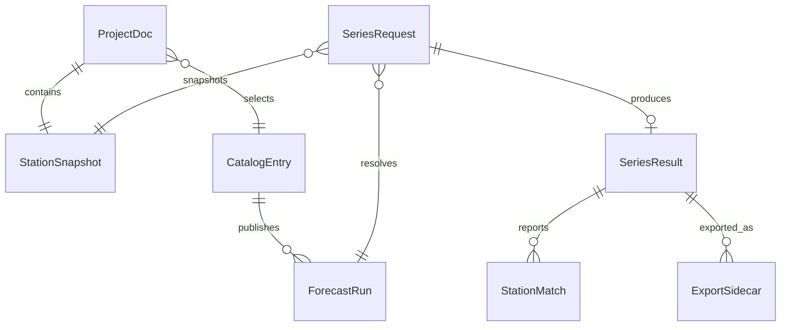

# Data Model: M1 Stations × Forecast Series

**Feature**: [spec.md](spec.md) · **Research**: [research.md](research.md)

Ownership follows Constitution I. Value types live in UI-free crates:
- `omo-project` owns documents, stations, and drafts;
- `omo-engine` owns catalog, grid, and series;
- `omo-protocol` owns wire bodies.

`omo-app::host` orchestrates. `omo-app::ui` only renders signals.

## StationSnapshot (`omo-project::stations`)

| Field | Type | Rule |
|---|---|---|
| `rows` | `Vec<StationRow>` | 1 ≤ len. Above 1,000 rows, the user must confirm a warning (provisional limit) |
| `content_sha256` | hex string | SHA-256 of the canonical CSV bytes (R-04) |
| `source` | `StationSource{orig_path, orig_sha256, imported_at_utc}` | provenance only; the snapshot never re-reads the source |
| `mapping` | `ColumnMapping{id, lat, lon, name?, elevation?}` | header names the user confirmed |

`StationRow { station_id: String, latitude: f64, longitude: f64, name: Option<String>, elevation_m: Option<f64> }`

Validation (`validate() -> Result<(), Vec<RowIssue>>`, which reports all issues at once):
- `station_id` is non-empty and unique.
- `latitude` ∈ [−90, 90].
- `longitude` ∈ [−180, 360], normalized to [−180, 180).
- Values are finite.

`RowIssue { line: u64, field, kind: Empty|Duplicate{first_line}|OutOfRange|NotNumber|Encoding }`

## ImportSession (`omo-project::stations::import`, transient)

The import moves through three states: `Parsed{headers, sample_rows(≤20), proposed_mapping, delimiter}`
→ `Validated{issues}` → `Confirmed(StationSnapshot)`. It is never persisted before
confirmation.

## CatalogEntry (`omo-engine::catalog`, schema `omo-catalog/1`)

| Field | Example (default) |
|---|---|
| `id` | `ecmwf_ifs.temperature_2m` |
| `product` | `{provider:"ECMWF", model:"IFS HRES", open_meteo_domain:"ecmwf_ifs"}` |
| `variable` | `{name:"temperature_2m", unit:"°C", label:"2 m air temperature"}` |
| `layout` | `{kind:"data_run", base:"s3://openmeteo/data_run/ecmwf_ifs/", latest:"latest.json", object:"{YYYY}/{MM}/{DD}/{HH}00Z/{variable}.om", meta:"{YYYY}/{MM}/{DD}/{HH}00Z/meta.json"}` |
| `grid` | `{kind:"reduced_gaussian_o1280", duckomo_domain:"ecmwf_ifs", points:6599680}` |
| `cycles` | `{"00":360,"06":144,"12":360,"18":144}` (horizon in hours) |
| `default_window_h` | `[0,168]` |
| `max_distance_m` | `7200` |
| `attribution` | list of verbatim strings (R-08) |
| `is_default` | `true` |

`Catalog { schema:"omo-catalog/1", version: String /* e.g. "2026-11-23.1" */, entries: Vec<CatalogEntry> }`.
Exactly one entry has `is_default`.

**Readiness** (`CatalogReadiness`, not persisted, so it does not change `version`):
- `Ready{latest_complete_run}`;
- `NotReady{reason: RemoteUnavailable|LatestMissing|VariableMissing|NoCompleteRun|GridMismatch, detail}`.

## ForecastRun (`omo-engine::catalog::run`)

`ForecastRun { reference_time_utc, cycle: "00"|"06"|"12"|"18", horizon_h, valid_times: Vec<UtcInstant>, object_url, meta_etag }`

Complete when `valid_times.last == reference_time + cycles[cycle]` and the variable is listed
(R-02). Resolved once per request (FR-008).

## LeadWindow (`omo-project::doc`)

`LeadWindow { start_h: u32, end_h: u32 }`, a closed interval with `start_h ≤ end_h ≤ 360`.
Default `[0,168]`.

`EffectiveWindow` is derived per run: `{requested, effective_end_h = min(end_h, horizon_h), truncated: bool}`.
For example, the requested `[0,168]` on a 06Z run gives `[0,144]` with `truncated = true`.

## SeriesRequest (task snapshot, `omo-protocol::series`)

| Field | Notes |
|---|---|
| `stations_ref` | path of the canonical stations CSV for this snapshot hash |
| `stations_sha256` | |
| `catalog_entry` | full `CatalogEntry` copy (immutable) |
| `catalog_version` | |
| `run` | `"latest_complete"` or an explicit `reference_time_utc` |
| `window` | `LeadWindow` |
| `max_distance_m` | |
| `result_id` | |
| `limits` | interactive row/byte limits (M0) |

The `PreviewKey` gains `run_ref` (the resolved reference time or `latest_complete`),
`window`, and `max_distance_m`:

`PreviewKey{doc_id, revision, view_id, query_hash, stations_hash, catalog_version, run_ref, window, max_distance_m, worker_generation}`

## SeriesResult

- **Rows**: the stable `station_series` schema (C-10). There are no extra consumer columns.
  - `source_object` is the `s3://` URL.
  - `object_version` is the run object's ETag.
- **Match report** (side table, not part of `station_series`):
  `StationMatch { station_id, status: Matched|NoMatch, flat_index?, grid_lat?, grid_lon?, distance_m?, reason?: InvalidCoordinate|BeyondMaxDistance|MissingSourceData }`.
- **Metadata**: `{run: ForecastRun summary, effective_window, plan:"G"|"B", scan_metrics, rows, truncated}`.
- **Files**: `<session_tmp>/g<gen>/<result_id>.arrow`, `<result_id>.parquet`,
  `<result_id>-matches.arrow`, and `-plot.arrow` (M0).
- **State**: `received` (in the session) → `saved` (export committed). It is never persisted
  in the project.

## ProjectDoc (`omo-project::doc`, file schema `omo-project/1`)

| Field | Persisted | Notes |
|---|---|---|
| `schema` | yes | `"omo-project/1"`. A newer major version is refused (FR-027) |
| `doc_id` | yes | UUID |
| `stations` | yes | `StationSnapshot` (inline) |
| `catalog_selection` | yes | `{entry_id, catalog_version}` |
| `window` | yes | `LeadWindow` |
| `max_distance_m` | yes | |
| `sql_tabs` | yes | `Vec<{title, sql}>` |
| `view` | yes | `{selected_station_ids, chart:{show_legend, y_auto}}` |
| `revision` / `saved_revision` | no (runtime) | `dirty = saved_revision != Some(revision)` |
| `path` | no (runtime) | |

State transitions: `edited` → `draft_staged` (draft written) → `saved` (atomic save). The
states `received` and `saved` for results are tracked separately (Constitution IV).

## Draft (`omo-project::draft`)

`Draft { doc_id, project_path?, base_saved_mtime?, staged_at_utc, doc: ProjectDoc }` at
`<app_data>/drafts/<doc_id>.json`.

Drafts are deleted after a successful save, or when the user discards recovery.

## ExportSidecar (`omo-export-sidecar/2`)

Extends M0 `/1` (`schema, job, bootstrap_report, duckomo{version,channel,sha256}, duckdb_version, data{file,sha256,format,rows}, attribution, created_at`) with:
- `stations{sha256, count}`;
- `catalog{entry_id, version}`;
- `run{reference_time_utc, cycle, object_url, object_version}`;
- `window{requested, effective, truncated}`;
- `plan`;
- `query?` (SQL text for SQL exports);
- `attribution` (now a list of strings, taken from the catalog entry).

The startup scan accepts both `/1` and `/2` (the saved predicate is unchanged).

## Relationships

