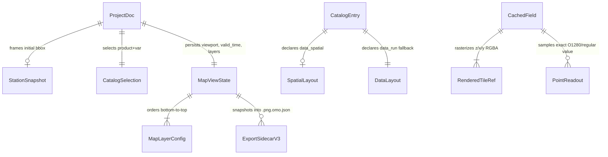

# Data Model: M2 Regional Tile Map & Layer Stack

**Feature**: [spec.md](spec.md) · **Research**: [research.md](research.md)

Ownership follows Constitution Principle I (UI-free core crates):
- `omo-project` owns persisted `MapViewState`, `MapLayerConfig`, `ColorScaleConfig`, and `MapPreviewKey`;
- `omo-protocol` owns wire bodies, `SpatialLayout`, `ValueProvenance`, `TileCoord`, and `SIDECAR_SCHEMA_V3`;
- `omo-engine` owns `CachedField`, `data_spatial`/`data_run` readers, `TrapezoidBilinear` / regular-grid tile rasterization, `OCB1` offline coastlines, and `.pmtiles` raster/MVT decoders;
- `omo-app::host` owns `MapRequestScheduler`, `mmap`/file RGBA buffer loading, and export sidecar assembly;
- `omo-app::ui` owns NSH reactive signals, keyed `ImageSrc::rgba` tile views, and `canvas(Painter)` overlays.

---

## 1. Catalog Extension: `SpatialLayout` (`omo-protocol::series`, schema `omo-catalog/1`)

Added as an optional field `#[serde(default, skip_serializing_if = "Option::is_none")] pub spatial_layout: Option<SpatialLayout>` on `CatalogEntry`:

| Field | Type | Rule / Default Example |
|---|---|---|
| `kind` | `String` | Must equal `"data_spatial"` (`CatalogValidationError::UnknownLayout` otherwise) |
| `base` | `String` | Non-empty `s3://` or `https://` prefix, e.g. `"s3://openmeteo/data_spatial/ecmwf_ifs/"` |
| `object` | `String` | Must contain run tokens (`{YYYY}`, `{MM}`, `{DD}`, `{HH}`) and valid-time tokens (`{valid_YYYY}`, `{valid_MM}`, `{valid_DD}`, `{valid_HH}`, `{valid_mm}`), e.g. `"{YYYY}/{MM}/{DD}/{HH}00Z/{valid_YYYY}-{valid_MM}-{valid_DD}T{valid_HH}{valid_mm}.om"` |

Run completeness and `latest_complete` resolution continue to use `CatalogEntry.layout` (`data_run` `latest.json` + `meta.json`).

---

## 2. Persisted Map State: `MapViewState` (`omo-project::doc`, file schema `omo-project/1`)

Added as `#[serde(default)] pub map: MapViewState` on `ProjectDoc`:

| Field | Type | Default & Validation Rule |
|---|---|---|
| `viewport` | `Option<MapViewport>` | `None` until user pans/zooms or saves explicit view (`None` means auto-fit confirmed stations on open per `FR-002`) |
| `valid_time_lead_h` | `u32` | `0` (`lead 0 h` of resolved run; clamped with visible flag if `> run.horizon_h`) |
| `color_scale` | `ColorScaleConfig` | `{ palette: "turbo", locked_min: None, locked_max: None }` |
| `layers` | `Vec<MapLayerConfig>` | Ordered bottom-to-top layer stack; defaults to `[builtin_coastlines (under/over configurable), forecast_field, station_overlay]` |

### `MapViewport`
- `center_lat: f64` — clamped to `[-85.05112878, 85.05112878]`; finite; `-0.0` normalized to `0.0`.
- `center_lon: f64` — normalized to `[-180.0, 180.0)`; finite; `-0.0` normalized to `0.0`.
- `zoom: u8` — clamped to `1..=12` (`FR-001`).

### `ColorScaleConfig`
- `palette: String` — one of built-in named palettes (`"turbo"`, `"viridis"`, `"coolwarm"`, `"magma"`, `"cividis"`).
- `locked_min: Option<f64>`, `locked_max: Option<f64>` — if both `Some`, requires `locked_min < locked_max` and finite; `None` uses the revision-wide `CachedField` `(auto_min, auto_max)` (`FR-010`).

### `MapLayerConfig`
| Field | Type | Rule |
|---|---|---|
| `id` | `String` | Stable unique ID within `layers` (e.g. `"forecast"`, `"coastlines"`, `"stations"`, or `"pmtiles-<uuid>"`) |
| `kind` | `MapLayerKind` | `ForecastField` \| `BuiltinCoastlines` \| `LocalPmtiles { path: PathBuf }` \| `StationOverlay` |
| `visible` | `bool` | Default `true` |
| `opacity` | `f32` | Clamped to `0.0..=1.0`, quantized/normalized (`-0.0 → 0.0`) |

---

## 3. Value Provenance & Layer Metadata (`omo-protocol::map`)

```rust
#[derive(Clone, Copy, Debug, Eq, PartialEq, Hash, Serialize, Deserialize)]
#[serde(rename_all = "snake_case")]
pub enum ValueProvenance {
    NativeNumeric,   // M2: OmWeatherLayer sampled directly from numeric CachedField
    PaletteDecoded,  // Reserved for post-M2 radiust-style validated palette/gray-code inversion
    DisplayOnly,     // M2: BuiltinCoastlines, StationOverlay, and M2 LocalPmtiles layers
}
```

### `PmtilesLayerInfo` (returned by `map_layer_probe`)
- `path: String`, `file_size: u64`, `fingerprint_sha256: Option<String>`
- `tile_kind: PmtilesTileKind` (`RasterPng` | `RasterJpeg` | `RasterWebp` | `VectorMvt`)
- `min_zoom: u8`, `max_zoom: u8`, `bounds: [f64; 4]` (`[min_lon, min_lat, max_lon, max_lat]`)
- `attribution: Option<String>`, `name: Option<String>`
- `value_provenance: ValueProvenance` (always `DisplayOnly` in M2)

---

## 4. Worker-Resident `CachedField` (`omo-engine::map::field`, transient per worker generation)

| Field | Type | Notes |
|---|---|---|
| `field_id` | `String` | Unique ID within worker generation |
| `entry_id` | `String` | e.g. `"ecmwf_ifs.temperature_2m"` |
| `reference_time_utc` | `String` | Resolved run RFC3339 UTC |
| `valid_time_utc` | `String` | Selected step RFC3339 UTC |
| `variable` / `unit` | `String` | e.g. `"temperature_2m"` / `"°C"` |
| `source_layout` | `SourceLayoutUsed` | `DataSpatial` \| `DataRunFallback` |
| `source_object` | `String` | Actual `s3://...` URL read |
| `object_version` | `Option<String>` | Observed ETag / version token (verified stable across band reads) |
| `coverage` | `FieldCoverage` | `Global` or `LatLonBbox { lat_min, lat_max, lon_segments }` |
| `values` | `GridValues` | `O1280Dense(Vec<f32>)` (`6,599,680 × 4 B = 26.4 MB`, `NAN` for unloaded/missing cells) or `Regular2D { ny, nx, values: Vec<f32> }` |
| `stats` | `FieldStats` | `{ valid_count, min_value: f32, max_value: f32 }` computed once on load for uniform tile normalization (`FR-010`) |

**State lifecycle**:
`Unloaded` → `LoadingSpatial` → (`FallbackDataRun` on `[object_not_found] (HTTP 404)`) → `Ready(CachedField)` | `Failed(FailKind)` | `Cancelled`.
Bounded in `EngineBackend` to at most **2** cached fields (`≤ 53 MB` RSS) with LRU eviction.

---

## 5. Tile Coordinates, Batches & Point Readout (`omo-protocol::map`)

- **`TileCoord`**: `{ z: u8, x: u32, y: u32 }` with `z ∈ 1..=12`, `x < (1 << z)`, `y < (1 << z)`.
- **`RenderedTileRef`**: `{ layer_id: String, z: u8, x: u32, y: u32, width: u32, height: u32, rgba_path: String }`, where `rgba_path` resides under `<result_root>/g<worker_generation>/` (`262,144 B` straight RGBA8 for `256×256`).
- **`PointReadout`**:
  - `latitude: f64`, `longitude: f64` (WGS 84 cursor/click location)
  - `forecast: ForecastSampleState`:
    - `Value { value: f32, unit: String, grid_lat: f64, grid_lon: f64, distance_m: f64, provenance: ValueProvenance::NativeNumeric, stale: bool }`
    - `NoData { grid_lat: f64, grid_lon: f64, distance_m: f64 }` (missing/null cell)
    - `OutsideCachedExtent` | `LayerHidden` | `NotLoaded`
  - `other_layers: Vec<LayerSampleNote>` (`{ layer_id, label, provenance: DisplayOnly }`)

---

## 6. `MapPreviewKey` (`omo-project::preview_key`)

```rust
pub struct MapPreviewKey {
    pub doc_id: String,
    pub revision: u64,
    pub stations_hash: Option<String>,
    pub catalog_entry_id: String,
    pub catalog_version: String,
    pub run_ref: String,
    pub valid_time_utc: String,
    pub color_palette: String,
    pub color_locked_range: Option<(u64, u64)>, // f64::to_bits after -0.0 -> 0.0 normalization
    pub layers_hash: String,                    // canonical digest of visible layers + opacities + order
    pub worker_generation: u64,
}
```

Any mismatch between the displayed map's `MapPreviewKey` and current project/worker state marks the map `Stale` (`FR-020`), while retaining the last valid tiles on screen.

---

## 7. `ExportSidecarV3` (`omo-protocol::export`, schema `omo-export-sidecar/3`)

Extends the atomic sidecar contract for composite PNG map exports (`<target>.png.omo.json`):
- Keeps top-level `"schema": "omo-export-sidecar/3"` and `"/data/sha256"` (`{ "file", "format": "png", "sha256", "bytes", "width", "height" }`) so `export_scan::is_saved` and `scan_export_dir` work unchanged.
- Adds `valid_time_utc`, `source_layout` (`"data_spatial"` | `"data_run"`), `viewport` (`bbox`, `center`, `zoom`), `color_scale` (`palette`, `min`, `max`, `unit`, `locked`), and `layers` (ordered array with `id`, `kind`, `opacity`, `value_provenance`, optional `.pmtiles` `path`/`sha256`/`attribution`).

---

## Relationships


